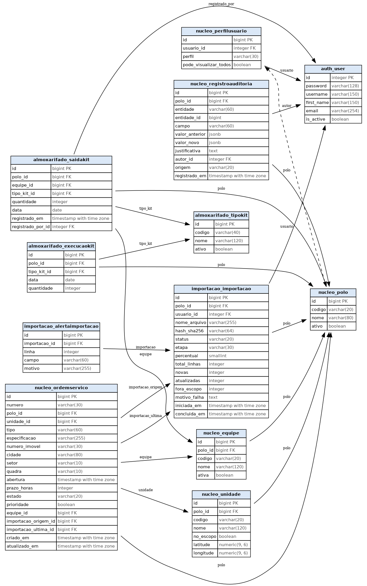

# Modelo de dados do MVP (Etapa 4)

O esquema foi derivado das 5 histórias priorizadas (`docs/historias-priorizadas.md`), do contrato da
API (`docs/contrato-api.md`) e do diagrama de classes C4 nível 4 (`docs/diagramas-c4/c4-nivel4-codigo.jpg`).
A fonte da verdade são os models Django em `backend/*/models.py`; as migrations versionadas ficam em
`backend/*/migrations/`.

- **Diagrama ER (imagem):** [`diagrama-er.png`](diagrama-er.png), gerado dos models por
  `scripts/gerar_diagrama_er.py` (Graphviz).
- **Diagrama ER (Mermaid, renderiza no GitHub):** [`diagrama-er.mmd`](diagrama-er.mmd).



## 1. Tabelas por módulo

| Módulo (app) | Tabela | Para quê |
|---|---|---|
| `nucleo` | `nucleo_polo` | Polos (Central, Norte, Sul). Cadastro: polo novo sem código (RNF-26) |
| `nucleo` | `auth_user` + `nucleo_perfilusuario` | Login individual, perfil e polos autorizados (HU-019/020) |
| `nucleo` | `nucleo_unidade` | Unidades do GSAN, com `no_escopo` (HU-003) e lat/long |
| `nucleo` | `nucleo_equipe` | Equipes de campo, cada uma de um polo (RF-EQP-03) |
| `nucleo` | `nucleo_ordemservico` | Carteira de OSs, chave `(numero, polo)` (RN-01) |
| `nucleo` | `nucleo_registroauditoria` | Trilha imutável (RNF-16, HU-045) |
| `importacao` | `importacao_importacao` | Cada importação: hash, status, resumo (HU-001..004) |
| `importacao` | `importacao_alertaimportacao` | Avisos não bloqueantes por linha |
| `almoxarifado` | `almoxarifado_tipokit` | Catálogo de kits (RF-ALM-02) |
| `almoxarifado` | `almoxarifado_execucaokit` | Execução por polo/kit/dia: o limite D-1 da trava (RN-11) |
| `almoxarifado` | `almoxarifado_saidakit` | Saídas de kit para equipes (HU-016) |

## 2. Toda informação exigida por uma história tem onde ser guardada?

| História | Lê | Grava | Onde está a informação exigida |
|---|---|---|---|
| HU-019/020 Login e polo | `auth_user`, `perfilusuario`, `polo` | — | nome, e-mail, perfil, `pode_visualizar_todos`, `polos_autorizados` (M2M) |
| HU-001 Upload | `polo` | `importacao` | `nome_arquivo`, `hash_sha256`, `usuario`, `iniciada_em` |
| HU-002 Layout | — | `importacao` (`RECUSADA`, `motivo_falha`) | colunas faltantes vão no `motivo_falha` e na resposta 422 |
| HU-003 Escopo | `unidade.no_escopo` | `importacao.fora_escopo` | OS fora de escopo **não** é gravada (RN-03), só contada |
| HU-004 Upsert | `ordemservico` | `ordemservico`, `importacao`, `alertaimportacao` | chave `(numero, polo)`; `CAMPOS_GSAN` separados do tratamento; `importacao_origem`/`importacao_ultima` (RN-L05) |
| HU-006/007/008 Pendências | `ordemservico`, `unidade`, `equipe` | `ordemservico.prioridade`, `estado`, `registroauditoria` | `abertura` + `prazo_horas` permitem calcular decorrido e atraso (RN-06) na consulta |
| HU-016 Trava de kit | `execucaokit` (D-1), `saidakit` (soma do dia), `equipe`, `tipokit` | `saidakit`, `registroauditoria` (tentativa bloqueada, CA08) | limite por `(polo, kit, data)`; saída guarda `data` para somar o dia |

## 3. Decisões e justificativas

| # | Decisão | Por quê |
|---|---|---|
| D1 | Chave natural `UNIQUE (numero, polo_id)` na OS, além do `id` | RN-01/CA07: a mesma OS em polos diferentes é outra OS; o banco impede duplicata mesmo com bug no código (CA09 idempotência) |
| D2 | `CHECK` nos campos enumerados (`estado`, `perfil`, `status`, `origem`) | `choices` do Django só valida em formulário; o CHECK protege contra `update()` e SQL direto |
| D3 | Sem coluna `desconsiderada` na OS; o contrato a expõe como propriedade derivada do `estado` | Duas fontes de verdade (booleano e estado) podem divergir. O diagrama C4 tinha o campo; removido conscientemente |
| D4 | `CAMPOS_GSAN` como constante no model | O upsert (Etapa 5) atualiza só esses campos; `estado`, `prioridade` e `equipe` nunca são sobrescritos (RN-02). Teste garante a separação |
| D5 | Trilha de auditoria append-only por **trigger** PostgreSQL (UPDATE/DELETE levantam erro) | RNF-16: nem admin, nem bug, nem SQL manual alteram o histórico. Testado em `nucleo/tests/test_esquema.py` |
| D6 | `RegistroAuditoria.polo_id` | `GET /auditoria/` precisa filtrar por `X-Polo-Id` sem fazer join com cada entidade auditada |
| D7 | Índice único **parcial** em `importacao(polo)` onde status está em andamento | Implementa o 409 do contrato (`garantir_unica_em_andamento`) no banco, à prova de corrida entre duas requisições |
| D8 | O arquivo `.xlsx` não é guardado; só `nome_arquivo` e `hash_sha256` | O disco do Render gratuito é efêmero. O hash basta para rastrear (HU-001) e detectar reenvio |
| D9 | `ExecucaoKit` com `UNIQUE (polo, tipo_kit, data)` | Uma linha por dia/polo/kit = consulta direta do limite D-1; populada por seed porque a HU-018 está fora do MVP |
| D10 | `SaidaKit.data` (date) separada de `registrado_em` | Soma das saídas do dia com índice `(polo, tipo_kit, data)`, sem converter timestamp por fuso na consulta |
| D11 | `PerfilUsuario` 1-1 com `auth.User` em vez de usuário customizado | A Etapa 2 já aplicou as migrations de `auth` no Neon; trocar `AUTH_USER_MODEL` agora exigiria recriar o banco. Login por e-mail usa `username = e-mail` |
| D12 | Latitude/longitude `DECIMAL(9,6)` em vez de PostGIS | O ADR prevê PostGIS para seleção por polígono (HU-012), que está fora do MVP; evita GDAL no build do Render |
| D13 | `on_delete=PROTECT` em todas as FKs de dados operacionais | Apagar polo, unidade, equipe ou usuário com histórico quebraria a rastreabilidade; inativa-se (`ativo`/`ativa`/`is_active`) |
| D14 | Índices `(polo, estado, abertura)` e parcial `(polo, estado) WHERE prioridade` na OS | São exatamente os filtros e a ordenação de `GET /ordens-servico/` |
| D15 | Seeds num app separado (`dados_demo`), proibido de ser importado pelo código de produção | Seed escreve em tabelas de vários módulos; isolado, não fere a regra "módulo não grava tabela de outro" (verificado por `lint-imports`) |

## 4. LGPD — dados pessoais

- **Guardados:** nome, sobrenome e e-mail dos **usuários do sistema** (necessários para login e para
  autoria da auditoria). Senha só como hash (PBKDF2 do Django).
- **Não guardados:** nome, CPF, telefone ou endereço do **cliente** da concessionária. Da OS ficam só
  dados operacionais (`numero_imovel`, setor, quadra, cidade). Se a planilha GSAN trouxer colunas
  pessoais, o leitor (Etapa 5) deve ignorá-las.
- O arquivo enviado não é armazenado (D8).
- Seeds usam apenas dados fictícios, domínio reservado `@genios.test`, e a senha vem de variável de
  ambiente (`SENHA_USUARIOS_DEMO`), nunca do código.

## 5. Riscos identificados

| Risco | Impacto | Mitigação |
|---|---|---|
| **Saídas simultâneas** ultrapassam a trava (HU-016 CA07) | Duas requisições leem o mesmo saldo e ambas gravam | O service da Etapa 5 deve travar a linha `ExecucaoKit(polo, kit, D-1)` com `select_for_update()` antes de somar e inserir; testar com `TransactionTestCase` |
| Equipe de outro polo numa `SaidaKit` ou OS | O banco não tem FK composta `(equipe, polo)` | Validar no service (403 do contrato); possível evolução: FK composta via SQL |
| Upsert de 5.000 linhas linha a linha (CA08: 3 min) | Lentidão no Render gratuito | Buscar OSs existentes do polo num único `filter(numero__in=...)` e usar `bulk_create` / `bulk_update` dentro de `transaction.atomic()` |
| Trilha de auditoria cresce sem limite | Consulta lenta | Índices `(entidade, entidade_id)` e `(polo, registrado_em)`; arquivamento fora do MVP |
| `TRUNCATE` não é bloqueado na auditoria | Um usuário com privilégio total pode apagar tudo | Deliberado, para o `flush` dos testes funcionar. Em produção, o papel da aplicação no Neon não deve ter `TRUNCATE` |
| Seeds de execução D-1 envelhecem | Após 14 dias sem rodar o seed, a trava bloqueia tudo (limite 0) | Rodar `popular_dados_demo` antes da demonstração (idempotente) |
| Dúvida em aberto: "D-1" em segunda-feira é domingo? (HU-016) | Limite 0 às segundas | Seed cobre todos os dias corridos; regra final decidida na Etapa 5 |
| `importacao_origem`/`importacao_ultima` ligam `nucleo` a `importacao` no esquema | Acoplamento de esquema entre módulos | Referência textual (`"importacao.Importacao"`), sem import Python; o `lint-imports` continua garantindo que o núcleo não depende do módulo em código |

## 6. Como aplicar

```bash
cd backend
python -m venv .venv && . .venv/bin/activate
pip install -r requirements-dev.txt
# DATABASE_URL no .env (Neon) — nunca versionado
python manage.py migrate                         # aplica do zero
SENHA_USUARIOS_DEMO='escolha-uma' python manage.py popular_dados_demo   # idempotente
python manage.py test                            # 23 testes, exigem PostgreSQL
```

Usuários de demonstração (todos com a senha definida em `SENHA_USUARIOS_DEMO`):

| E-mail | Perfil | Polos |
|---|---|---|
| `ana.analista@genios.test` | Analista de Operações | todos |
| `bruno.norte@genios.test` | Analista de Operações | só Polo 2 (testar 403) |
| `carlos.almox@genios.test` | Almoxarife | só Polo 1 |
| `gabriela.gerente@genios.test` | Gerente de Contrato | todos |
| `alice.auditora@genios.test` | Auditor | todos |
| `davi.admin@genios.test` | Administrador | todos |

Conferência no editor SQL do console do Neon:

```sql
SELECT estado, count(*) FROM nucleo_ordemservico GROUP BY estado;          -- 30/6/6/6
SELECT p.codigo, k.codigo, e.quantidade FROM almoxarifado_execucaokit e
  JOIN nucleo_polo p ON p.id = e.polo_id JOIN almoxarifado_tipokit k ON k.id = e.tipo_kit_id
 WHERE e.data = current_date - 1;                                           -- limites D-1
UPDATE nucleo_registroauditoria SET justificativa = 'x';                    -- deve falhar
```
